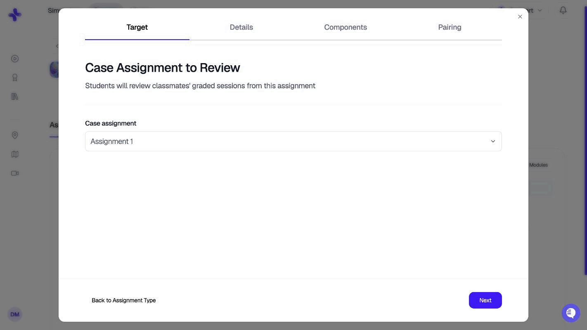
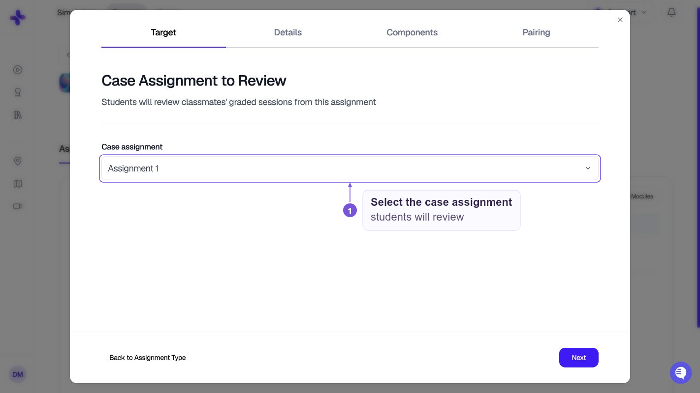
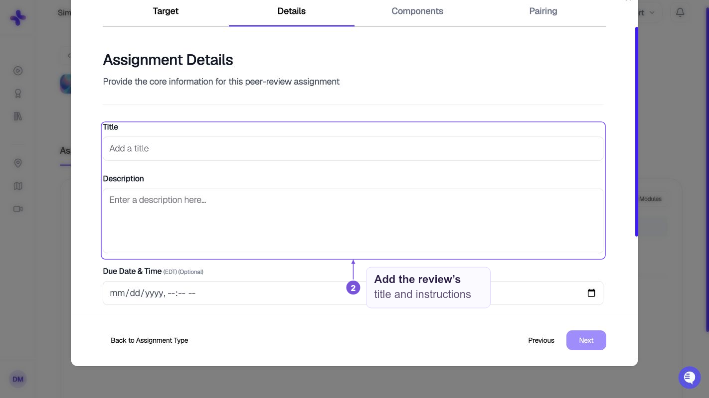
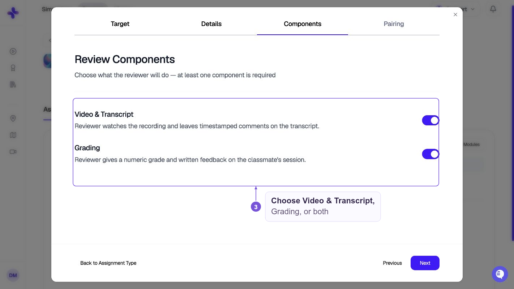
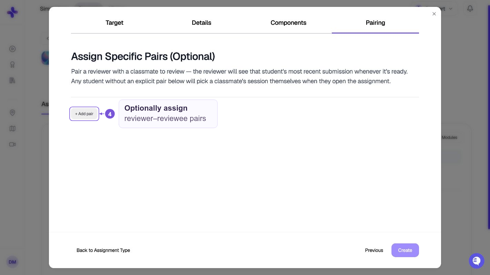
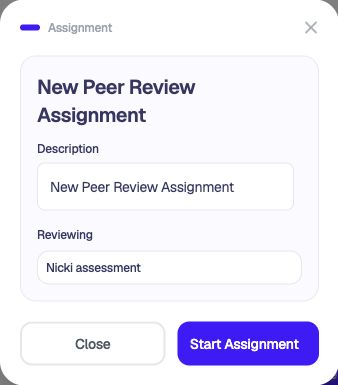
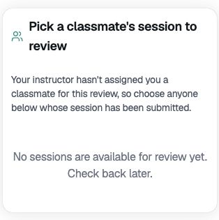
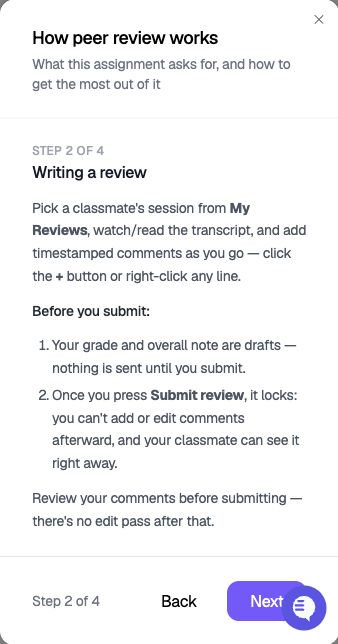
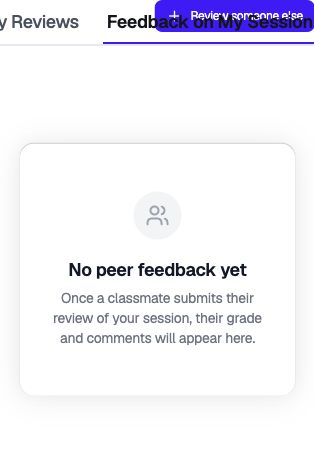

Peer review is an assignment type that lets students review a classmate's simulation session. A reviewer watches the recording, leaves timestamped comments on the transcript, and can give a grade with written feedback — the same UI instructors use to grade cases, minus the AI feedback.

Use peer review when you want students to practice giving clinical feedback, learn by evaluating classmates' work, or add a second layer of review on top of AI and instructor grading.

## How it works

A peer review assignment always points at an existing **case assignment** — the "target." Students who have submitted the target case are the pool of reviewees.

- Reviewers open the assignment and either see a **pre-assigned classmate** (if you paired them) or **pick a classmate's session** from the graded pool.
- The reviewer watches the recording, comments on the transcript, and — if you enabled grading — enters a numeric grade and written feedback.
- Comments are visible to the reviewed student **as soon as the reviewer submits** — there is no separate release step.
- You can optionally grade the reviewer's effort separately in the teacher view.

<Note>Peer review does not use AI feedback. Reviewers see only the raw video, transcript, and their classmates' comments — not SimCare's AI evaluations of the session.</Note>

## Creating a peer review assignment

Open a class, go to the **Assignments** tab, and select **Create assignment**. Choose **Peer review** as the type. The builder has four steps.

<Steps>
  <Step title="Target">
    Pick the case assignment that reviewers will review. Only case assignments already in this class can be targets — create the case assignment first if it doesn't exist yet.

    
  </Step>
  <Step title="Details">
    Set the title, description, optional due date, and whether to publish immediately. Same fields as a case assignment.

    
  </Step>
  <Step title="Components">
    Choose what the reviewer does. At least one is required:

    | Component | What the reviewer does |
    |---|---|
    | **Video & Transcript** | Watches the recording and leaves timestamped comments on the transcript |
    | **Grading** | Enters a numeric grade (0–100) and written feedback on the classmate's session |

    Enable both for a full review, or just one to keep the scope tight (for example, comments-only for a low-stakes practice pass).

    
  </Step>
  <Step title="Pairing">
    Optionally assign explicit reviewer → reviewee pairs. Anyone left unpaired self-selects a classmate's session from the graded pool when they open the assignment.

    Pairing targets a **student**, not a specific attempt — the reviewer will always see that student's most recent submitted attempt. If the paired reviewee hasn't submitted yet, the reviewer sees a "not submitted yet" state until they do.

    
  </Step>
</Steps>

## Student experience

From **My Learning**, find the peer review assignment under **Upcoming**. Choose **View Details** to check the target case under **Reviewing**, then **Start Assignment**.

Open **My Reviews** to review a classmate:

- **If you paired them**, the assignment opens straight into the review screen for their assigned classmate's session.
- **If they're unpaired**, they choose from classmates who have submitted the target case. If the list says **No sessions are available for review yet**, check back after a classmate submits.

The review screen keeps the recording pinned beside the transcript, so you can keep watching while you scroll. If grading is enabled, a **Grading** step appears first. Peer comments appear on the transcript tagged as **Peer** so the reviewed student can tell them apart from instructor or AI comments.

To comment on a specific moment, use **+** beside a transcript line. Check your comments, grade, and overall note before choosing **Submit review**. Submission locks the review and makes it visible to your classmate. Open **Help** for an in-app walkthrough.

Select **Feedback on My Session** to read reviews of your own work. This tab is separate from the reviews you write. It shows **No peer feedback yet** until a classmate submits a review of your session.

## Reviewing peer work as an instructor

Open the peer review assignment from the class **Assignments** tab. The teacher view is organized by **reviewer**, not by reviewee:

- Left rail — every reviewer, with the classmates they reviewed nested underneath.
- Main area — the selected review, showing the reviewee's transcript with the reviewer's comments and grade in read-only mode.
- Optional **review grade** — give the reviewer a numeric grade and written feedback on how well they reviewed. This is separate from the grade the reviewer gave the reviewee's session. If the class is linked to your LMS, the review grade you save is sent to the LMS gradebook. If it can't be sent, you see a warning.
- The overall written feedback box is always available, even when **Grading** is off for the assignment. **Grading** only controls the numeric score.

You can jump between a reviewer's reviews without leaving the page to see their whole body of peer feedback at once.

## Where peer feedback appears for the reviewed student

The student being reviewed sees peer comments on their case review, alongside AI and instructor feedback. Peer comments are tagged with the reviewer's name and a **Peer** badge, and are timestamped to the moment in the session they're anchored to.

## Limits

- The target must be a **case assignment** — you can't peer review a quiz, document, or another peer review.
- Existing pairs can't be edited from the builder after creation. Add new pairs to layer on top; leave a student unpaired to let them self-select.
- Peer review is not yet available in the **Course Builder** for course-level templates — create peer review assignments directly on the class.
